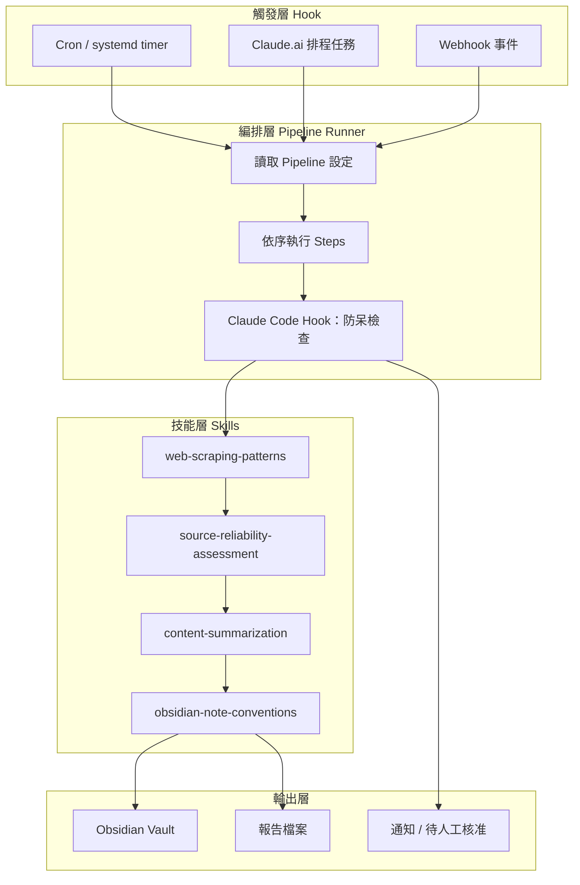
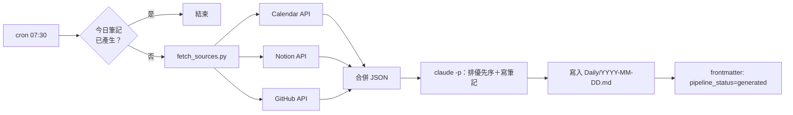
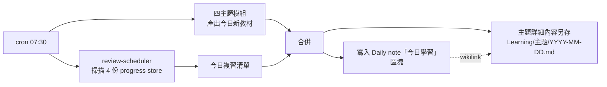

# AI Pipeline + Hook 排程系統 — 架構規格

## 一、核心概念

- **Hook（觸發層）**：決定「何時、因為什麼事」啟動一次執行——時間到（cron）、事件發生（webhook）、或手動觸發。
- **Pipeline（管線）**：Hook 觸發後依序執行的步驟，固定套路 `讀取來源 → 處理/判斷 → 產出 → 通知`。
- Claude Code 自身的「Hooks」機制（`PreToolUse`/`PostToolUse`/`Stop` 等）只用於單一 pipeline 執行過程中的防呆檢查，不用於排程。



## 二、系統原則（全部 pipeline 共用）

1. **程式碼與資料分開**：`pipelines/`（設定）與 `runner/`（程式碼）進 Git；Obsidian vault、媒體檔案、progress store、analytics 等狀態性資料一律不進 Git。
2. **Write-back**：每次執行完把結果狀態（`status`/`generated_at`/`next_review` 等）寫回資料本身（frontmatter 或 progress store），作為下次執行判斷依據，不另建資料庫。
3. **機械抓取交給程式碼，判斷/寫作交給 Claude**：來源 API 呼叫用固定 script；Claude 只做需要判斷力的排序/摘要/寫作。
4. **輕量骨架優先**：不預先蓋通用框架，等模式重複出現再抽共用模組。

## 三、執行環境

| Pipeline | 環境 | 理由 |
|---|---|---|
| 1 daily-job-schedule | Claude Code + cron | 需讀寫本機 repo/Obsidian vault |
| 2 daily-news-report | Claude.ai 排程任務優先 | 純內容產出，無外部狀態寫入 |
| 3 daily-media-management | Claude Code + cron | 需要人工核准 gate、狀態寫回、媒體 worker |
| 4 daily-ego-learning | Claude Code + cron | 需讀寫 progress store、Obsidian vault |
| 5 daily-self-awareness | Claude.ai 排程任務優先 | 純計算產出，無外部狀態寫入 |

## 四、Pipeline 總覽

| # | 名稱 | 性質 | 狀態 | 主要輸出 |
|---|---|---|---|---|
| 1 | `daily-job-schedule` | 個人行程/任務彙整 | 否（write-back 防重複） | `Daily/YYYY-MM-DD.md` 主體 |
| 2 | `daily-news-report` | 外部世界知識彙整（五大領域） | 否 | 獨立報告 |
| 3 | `daily-media-management` | 社群媒體：互動／發佈／週期性成效回顧 | 是（發佈狀態、成效數據） | 外部平台＋獨立 log |
| 4 | `daily-ego-learning` | 個人學習：西語／舞蹈／程式／易經道學 | 是（進度／間隔複習） | `Daily/YYYY-MM-DD.md` 區塊＋主題筆記 |
| 5 | `daily-self-awareness` | 每日命理：八字／紫微斗數／人類圖／占星 | 否 | `Daily/YYYY-MM-DD.md` 區塊 |

## 五、專案結構

```
personal-automation/
├── pipelines/
│   ├── daily-job-schedule.yaml
│   ├── daily-news-report.yaml
│   ├── daily-media-management/
│   │   ├── engagement.yaml            # 3a
│   │   ├── publish-image-text.yaml    # 3b 車道一
│   │   ├── publish-video-audio.yaml   # 3b 車道二
│   │   └── performance-review.yaml    # 3c，週期性
│   ├── daily-ego-learning/
│   │   ├── spanish.yaml
│   │   ├── dance.yaml
│   │   ├── coding.yaml
│   │   ├── iching-daoism.yaml
│   │   └── review-scheduler.yaml
│   └── daily-self-awareness/
│       ├── bazi.yaml
│       ├── ziwei.yaml
│       ├── human-design.yaml
│       ├── astrology.yaml
│       └── birth-profile.yaml
├── workers/
│   └── media-processor/       # FFmpeg + 上傳，獨立部署
├── runner/
│   └── pipeline_runner.py     # 全部 pipeline 共用
├── hooks/
│   ├── pre_run.sh
│   └── post_run.sh
└── README.md
```

**不進 repo**：Obsidian vault 本體、媒體檔案（S3/R2）、`data/learning-progress/*.yaml`、analytics store（SQLite）。

## 六、Pipeline 規格

### Pipeline 1｜daily-job-schedule

**Hook**：cron，工作日 07:30

**資料來源**

| 來源 | 抓取方式 | 認證 | 抓什麼 |
|---|---|---|---|
| Google Calendar | Calendar API（REST） | OAuth refresh token | 今日事件，判斷會議 vs 深度工作時段 |
| Notion | `POST /v1/databases/{id}/query` | Internal Integration token | Tasks：assignee=我、status≠Done、due≤今天 |
| GitHub | `gh` CLI / REST `/search/issues` | Fine-grained PAT | assigned issue/PR、review-requested PR |

**流程**



**Frontmatter**

```yaml
---
created: 2026-08-07
tags: [daily-note, worklog, worklog/job]
aliases: []
pipeline_status: generated   # generated | failed
generated_at: 2026-08-07T07:31:02+08:00
sources: [google-calendar, notion, github]
---
```

**判斷邏輯**：負荷分類 HEAVY(≥5h會議/3+群聚)／NORMAL／OPEN；優先序 review-requested PR／今日到期任務 ＞ 一般 assigned ＞ 無 due date；輸出結構＝行事曆總覽 → 待處理任務 → 建議深度工作時段

**技能**：`obsidian-note-conventions`、`test-script-conventions`

**待確認**：Notion Tasks 欄位命名、Obsidian vault 路徑、是否需要通知機制

**TimeCare 整合（未來）**：現階段不整合。TimeCare 有 GitHub repo 後先併入資料來源掃描；有後端後端口建在 TimeCare 側，Pipeline 1 runner 當呼叫方。

---

### Pipeline 2｜daily-news-report

**Hook**：Claude.ai 排程任務，每日 06:30

**涵蓋範圍**：五大知識領域（地緣政治／巨觀經濟與金融市場／資訊科技與 AI／生醫科技／硬體工程與能源），Top 5–7 議題，What/Why/So What 三段式，A4 單頁排版

**步驟**：`web-scraping-patterns` 抓取 → `source-reliability-assessment` 過濾 → 降噪去重 → 重要度評級選 Top 5–7 → `content-summarization` 產出摘要 → （學術類另加 `academic-citation-review`）→ 依 A4 規格輸出，`obsidian-note-conventions` 存 vault，可選寄送通知

**技能**：`web-scraping-patterns`、`source-reliability-assessment`、`content-summarization`、`obsidian-note-conventions`、`academic-citation-review`（視內容而定）

---

### Pipeline 3｜daily-media-management

**3a 社群互動管理**
- Hook：webhook（新留言/私訊）＋ 每日排程（成效彙整）
- 流程：監控 → 分類（需回覆／一般／垃圾）→ 草擬回覆（多方案）→ **人工核准 gate** → 發布 → 記錄成效
- 原則：不自動發文，AI 僅草擬＋分類

**3b 社群內容發佈**（Git/Markdown SSOT，兩車道）

| 車道 | 涵蓋 | 執行位置 |
|---|---|---|
| 圖文類 | Blog／LinkedIn／X／Threads／IG 貼文/輪播／Medium(import) | GitHub Actions |
| 影音類 | YouTube／TikTok／IG Reels／Spotify Podcast | 獨立常駐 worker（FFmpeg） |

- 3b 為 orchestrator：讀 frontmatter `type`/`targets` 分派到對應車道，車道產出後統一 write-back
- `type`: `text | image | video | audio`（v1 圖文合併一支 script、影音合併一個 worker，資料模型不變）
- Direct Post 一律改用 **TikTok Creator's Draft**（草稿待手動確認，核准 gate 由平台原生提供）
- Medium 不做（2025 起關閉新申請，既有 token 也不穩定）

**3c 內容成效回顧**（週期性，非每日）
- Hook：每週或每月一次
- 資料來源：3b 的 analytics store（SQLite，slug 為 join key），需 3b 已累積資料
- 流程：跨平台/主題趨勢分析 → 舊主題檢討（標註可能原因）→ 產出 2–3 個延伸內容構想（寫成 draft，**不自動接發佈**）→ 輸出週期報告
- v1 範圍刻意收斂：僅每週 2–3 個候選構想＋簡短理由，不做開放式策略引擎

---

### Pipeline 4｜daily-ego-learning

**涵蓋主題**：西班牙文、身體舞蹈訓練、程式作業練習、易經＋道學練習（道家/道教）——四主題共用同一套 progress store schema 與複習排程機制

**共用 Schema**

```yaml
# data/learning-progress/<topic>.yaml
curriculum_pointer: <目前進度>
items:
  - id: <項目 ID>
    learned_at: <首次學習日期>
    last_review: <上次複習日期>
    interval_days: <間隔天數>
    next_review: <下次複習日期>
    ease: <難易度係數，SM-2>
```

| 主題 | `items` 內容 | `curriculum_pointer` 範例 |
|---|---|---|
| 西班牙文 | 單字/文法點 | `lesson-12` |
| 身體舞蹈訓練 | 動作組合/套路片段 | `routine-week-3` |
| 程式作業練習 | 題型/概念 | `topic-binary-search` |
| 易經＋道學 | 64 卦意涵、道家概念條目 | `hexagram-12` |

易經模組另附加「今日起卦」（日期起卦，梅花易數）作為每日應用練習，與複習排程各自獨立運作。

**流程**



review-scheduler 只認 schema 欄位、不涉入主題內容，新增主題只需新增一份符合 schema 的 progress store。

**輸出**：Daily note 放精簡摘要（今日新學習 ×4、今日複習 N 項），細節存 `Learning/Spanish/`、`Learning/Dance/`、`Learning/Coding/`、`Learning/IChing-Daoism/`，wikilink 回連

**技能**：`test-script-conventions`（程式練習）、`obsidian-note-conventions`

---

### Pipeline 5｜daily-self-awareness

**涵蓋系統**：八字、紫微斗數、人類圖、占星——同構，均為「本命盤＋今日星象」固定計算

**共用輸入**：`config/birth-profile.yaml`（出生日期/時間/地點）

**流程**：四系統模組各自計算 → 合併為「今日基調」精簡摘要（每系統 1–2 句）→ 寫入 Daily note 對應區塊；完整命盤另存 `Awareness/系統名/YYYY-MM-DD.md` 並 wikilink 回連

---

## 七、新增知識/學習領域分類判準

| 問題 | 答案 A | 答案 B |
|---|---|---|
| 來源是會變動的外部事件，需要可信度判斷/去重嗎？ | 是 → Pipeline 2 | 否 → Pipeline 4 或 5 |
| 需要記得「昨天做到哪」的累積狀態嗎？ | 是 → Pipeline 4（progress store＋複習排程） | 否 → Pipeline 5（純每日計算） |
| 產出是「今天要做的練習」還是「今天要知道的事」？ | 行動練習 → Daily note 行動區塊 | 資訊/自我覺察 → Daily note 知識區塊，或獨立報告 |

## 八、建置順序

1. Pipeline 1（daily-job-schedule）— 驗證 runner 骨架
2. Pipeline 2（daily-news-report）— 重用 runner，換設定檔
3. Pipeline 5（daily-self-awareness）— 先做 1–2 套系統（占星、人類圖）
4. Pipeline 4（daily-ego-learning）— 先做 1 個主題（建議程式練習）驗證共用 schema
5. Pipeline 3a＋3b（daily-media-management）— 3b 兩車道 → 3a → `workers/media-processor`
6. Pipeline 3c（內容成效回顧）— 待 3b 累積 analytics 資料後再做

## 九、開發前待確認清單

- [ ] Obsidian vault 實際路徑
- [ ] Notion Tasks 資料庫欄位命名（status/due date）
- [ ] Google Calendar / Notion / GitHub 認證憑證申請與存放位置（`.env`，不進 repo）
- [ ] 出生資料（`birth-profile.yaml`）
- [ ] 各學習主題 v1 教材/來源（西語教材、舞蹈套路來源、易經/道學參考文本）
- [ ] 社群平台 API 申請進度（TikTok Creator's Draft、Instagram Graph API 等）
- [ ] 是否需要通知機制（Slack/ntfy），或先以「打開 Obsidian 才看到」為 v1 預設
